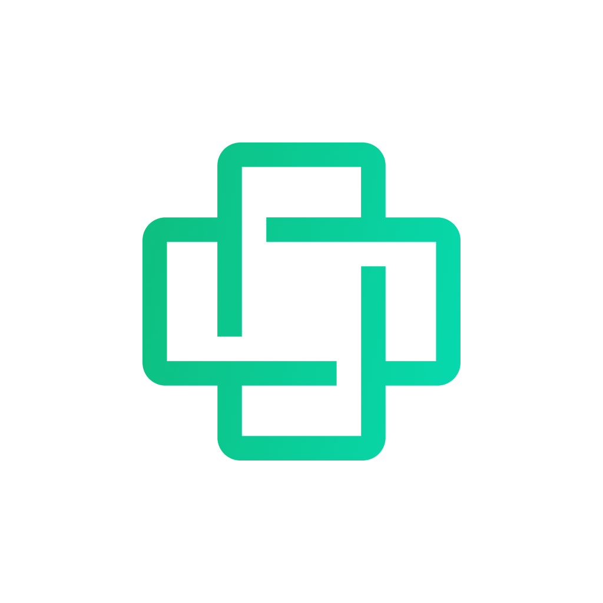
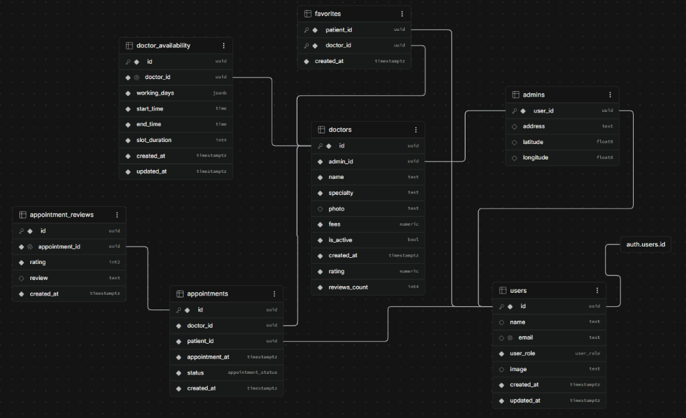

# Doctor Hunt 🩺

<div align="center">



### Advanced Doctor Discovery & Appointment Booking Ecosystem

[](https://flutter.dev)
[](https://dart.dev)
[](https://supabase.com)
[](https://bloclibrary.dev)
[](#technical-architecture)
[](#license)

<br/>

**Doctor Hunt** is an enterprise-grade medical consultation and clinic appointment management platform built with **Flutter** and powered by **Supabase**. Built on a Feature-First MVVM + EDA architecture — BLoC/Cubit as the ViewModel layer, and `AppEventBus` for reactive cross-feature event synchronization — alongside a zero-latency appointment scheduling engine.

</div>

---

## 📑 Table of Contents

- [Overview](#-overview)
- [Vision & Core Invariants](#-vision--core-invariants)
- [Video Demonstrations](#-video-demonstrations)
- [Feature Matrix](#-feature-matrix)
  - [Patient Experience](#patient-experience)
  - [Admin Clinic Management](#admin-clinic-management)
- [Technical Architecture](#-technical-architecture)
- [Technology Stack](#-technology-stack)
- [Database & Backend Design](#-database--backend-design)
- [Folder Structure](#-folder-structure)
- [Testing & Quality Assurance](#-testing--quality-assurance)

---

## 💡 Overview

Finding the right doctor and booking an appointment should be effortless — but in most clinics, it's still fragmented, manual, and frustrating for both patients and administrators.

**Doctor Hunt** is a mobile platform that connects patients with specialist doctors at a single clinic through a clean, guided booking experience — while giving the clinic administrator a powerful management portal to oversee every doctor, appointment, and operation in one place.

### Who Uses It

- 🧑‍⚕️ **Patients** — Browse doctors, book slots, track appointments, leave reviews, save favorites
- 🏥 **Clinic Admin** — Manage doctors, control availability, oversee all appointments, configure clinic location

### The Flow in One Line
```
Patient: Find Doctor ➔ View Profile ➔ Pick Date & Slot ➔ Book ➔ Rate After Visit
Admin:   Add Doctor ➔ Set Schedule ➔ Monitor Appointments ➔ Mark Complete / Cancel
```

---

## 🎯 Vision & Core Invariants

Doctor Hunt eliminates operational clinic overhead by providing a streamlined, linear patient-to-doctor booking journey combined with centralized administrative control.

```
Find Doctor ➔ Doctor Details ➔ Select Date & Slot ➔ Instant Booking ➔ Post-Visit Review
```

### Core Architectural Invariants:
1. **Centralized Location Inheritance**: Doctors do not define individual clinic locations. All doctors inherit the physical clinic location set centrally by the Clinic Administrator. Changing it updates all doctors platform-wide in real time.
2. **Strict 3-State Lifecycle**: Appointments follow an immutable 3-state state machine: `Upcoming` ➔ `Completed` or `Cancelled`.
3. **No Standalone Doctor Login**: Doctors are managed and scheduled exclusively through the Clinic Admin Portal, keeping doctor management agile and operationally secure.
4. **Resilient Scheduling Engine**: Dynamic slot generation based on weekly working days, start/end hours, configurable slot durations, and automatic exclusion of booked slots and elapsed past times.

---

## 🎥 Video Demonstrations

<div align="center">

> 📌 **Videos will be available after the first push** — upload them via GitHub's drag & drop editor to get a permanent CDN link, then replace the placeholders below.

| 📱 Patient Demo | 🖥️ Admin Demo |
| :---: | :---: |
| `<!-- paste patient demo video link here -->` | `<!-- paste admin demo video link here -->` |
| *Doctor discovery, live search, 1-tap favorites, real-time slot booking, rating & review.* | *Doctor management, working hours & availability setup, clinic map location, appointment control.* |

</div>

---

## 🚀 Feature Matrix

### Patient Experience
- **Onboarding & Splash**: Smooth onboarding walkthrough with brand animations, skip/get started triggers, and native splash screens.
- **Authentication**:
  - Email & Password Sign Up and Sign In.
  - Native Google OAuth integration with ID Token verification.
  - Forgot password flow with 6-digit OTP verification and secure password reset.
- **Home & Discovery**:
  - Personalized patient greeting and profile avatar.
  - Quick Specialty Filters: Dental, Cardiology, Ophthalmology, Dermatology with customized gradients.
  - **Popular Doctors**: Real-time listing sorted by review counts (`reviews_count` descending).
  - **Top Rated Doctors**: Highly rated medical professionals sorted by rating (`rating` descending).
- **Search & Filtering**:
  - Live doctor search by name with active-status verification (`is_active = true`).
  - Specialty filtering chips and dedicated category screens.
- **1-Tap Favorites**:
  - Instant toggle to save/remove favorite doctors.
  - Dedicated Favorites screen with search and instant state synchronization across the app.
- **Doctor Details**:
  - Profile avatar, full name, specialty, consultation fees, and aggregate rating.
  - Interactive Leaflet / OpenStreetMap clinic location preview.
  - Direct "Book Now" CTA linking into the booking engine.
- **Interactive Booking Engine**:
  - Calendar date picker with working days synchronization.
  - Automatic time slot generation based on doctor shift times and interval duration (e.g. 30 min).
  - Past-time protection: automatically excludes elapsed times on the current day.
  - Instant booking confirmation powered by an atomic Supabase RPC procedure.
- **Appointment Management**:
  - 3 dedicated status tabs: `Upcoming`, `Completed`, and `Cancelled`.
  - Self-service cancellation for upcoming visits with confirmation dialog.
  - Detailed Appointment view with doctor, schedule, and location cards.
- **Post-Visit Reviews Engine**:
  - Strictly restricted to `Completed` appointments.
  - Interactive 1–5 star rating with optional text comment.
  - View submitted reviews or leave feedback instantly.
- **Settings & Localization**:
  - Arabic and English multi-language support (RTL/LTR) with persistent local storage.
  - Change password and profile info.
  - Secure session termination with in-memory state flushing (`RemoveUserEvent`).

---

### Admin Clinic Management
- **Role Entry Separation**: Explicit entry point for Clinic Administrators.
- **Doctor Catalog Directory**:
  - Real-time statistics counters for **Total Doctors** and **Active Doctors**.
  - Doctor search by name and specialty filter tabs.
  - Dedicated doctor card preview with fee, specialty, rating, and live operational status pill.
- **Strict Doctor Creation & Modification**:
  - Add doctor with: Photo, Full Name, Medical Specialty, and Consultation Fee.
  - Adheres strictly to central location inheritance (no duplicate address entry).
  - High-performance image upload and atomic record management via Supabase Edge Functions.
- **Operational Status Control**:
  - Instant Toggle between **Active** and **Inactive** instead of permanent deletion, preserving patient booking histories.
- **Doctor Availability Engine**:
  - Configure working days (Monday through Sunday toggle switches).
  - Set working hours (Start Time and End Time via native time picker).
  - Configure slot duration intervals (30m, 45m, 60m).
- **Clinic Location & Central Propagation**:
  - Pin-drop interactive map picker (`flutter_map` & `latlong2`) for the physical clinic headquarters.
  - Instantly propagates coordinates and physical address to all doctor profiles.
- **Appointment Operations**:
  - Comprehensive oversight across `Upcoming`, `Completed`, and `Cancelled` appointments.
  - Actionable controls: Cancel appointment or Mark as Completed.
  - Patient contact details embedded directly within appointment details.

---

## 🏗️ Technical Architecture

Doctor Hunt follows a **Feature-First MVVM** architecture, where code is organized around **features/domains** rather than layers, and the **BLoC/Cubit** acts as the `ViewModel` in MVVM — holding business logic and state while remaining completely decoupled from the UI.

| MVVM Role | Implementation |
| :--- | :--- |
| **View** | Flutter Widgets (`*_screen.dart`, `*_widget.dart`) |
| **ViewModel** | BLoC / Cubit (`*_bloc.dart`, `*_cubit.dart`) |
| **Model** | Repositories, Services, Supabase DataSources, Domain Models |

```
lib/
├── app/
│   ├── core/                  # Shared framework & cross-cutting concerns
│   │   ├── app_events/        # Reactive AppEventBus for cross-bloc synchronization
│   │   ├── constants/         # Supabase, Hive, Maps constants
│   │   ├── di/                # Injectable & GetIt configuration
│   │   ├── error/             # ErrorHandler, Failure, and FailureCodes
│   │   ├── extensions/        # Context, SizedBox, String, and SnackBar extensions
│   │   ├── routing/           # Type-safe GoRouter routes ($appRoutes)
│   │   ├── shared/            # Shared models, enums, services & controllers
│   │   ├── theme/             # AppColors, Typography extensions, AppTheme
│   │   └── widgets/           # Reusable UI widgets (AppButton, AppTextField, Shimmers)
│   └── features/              # Modular domain features
│       ├── admin/             # Admin features (doctors, availability, appointments, profile)
│       ├── common/            # Shared features (auth, onboarding, splash, choose role)
│       └── patient/           # Patient features (home, booking, appointments, details, favorites)
├── generated/                 # Slang translation delegates & code-gen
├── doctor_hunt_app.dart       # Root application widget & Global Bloc providers
└── main.dart                  # Application entry point & service bootstrap
```

### Architectural Highlights:
- **Feature-First Folder Structure**: Each feature (`patient_home`, `admin_doctors`, etc.) encapsulates its own `data/` (services, models, repos) and `presentation/` (BLoC, screens, widgets), keeping features independently navigable and scalable.
- **Reactive Event Bus (`AppEventBus`)**: Bridges cross-feature side-effects without coupling BLoCs directly. Cancelling or completing an appointment notifies the list BLoC instantly through a broadcast stream — no callback chains, no prop-drilling.
- **Type-Safe Routing (`go_router`)**: Fully declarative routing via `go_router_builder`. Uses `StatefulShellRoute` for preserved bottom-navigation tab state.
- **Design System & Scalability**: Screen dimensions adapt responsively using `flutter_screenutil` (375×812 base design). Micro-spacing is strictly standardized using `.height` and `.width` extension getters.
- **Consistent Skeleton Loading**: Loading states mirror the real widget geometry with co-located `AppShimmer` skeletons, eliminating generic spinner flicker.

---

## 🛠️ Technology Stack

| Layer | Technologies & Packages |
| :--- | :--- |
| **Framework & Language** | Flutter 3.44+, Dart 3.11+ |
| **State Management** | `flutter_bloc` 9.1+, `bloc_concurrency`, `stream_transform`, `equatable` |
| **Backend & Cloud** | Supabase (`supabase_flutter` 2.17+), PostgreSQL, Edge Functions |
| **Authentication** | Supabase Auth, Google Sign-In (`google_sign_in` 7.2+) |
| **Navigation** | `go_router` 18.0+, `go_router_builder` |
| **Dependency Injection** | `get_it` 9.3+, `injectable` 3.0+ |
| **Local Storage & Cache** | `hive_ce` 2.20+, `hive_ce_flutter`, `cached_network_image` |
| **Maps & Geolocation** | `flutter_map` 7.0+, `latlong2`, `geolocator` |
| **Internationalization** | `slang` 4.19+, `slang_flutter`, `flutter_localizations` |
| **UI Components** | `flutter_screenutil`, `pinput`, `date_picker_plus`, `flutter_svg`, `lottie`, `shimmer` |
| **Testing & Mocking** | `flutter_test`, `bloc_test`, `mocktail` |

---

## 🗄️ Database & Backend Design

The backend is built on Supabase PostgreSQL with strict relational integrity, custom enum types, Row Level Security (RLS), and atomic procedures.

<div align="center">



</div>

### Relational Schema Breakdown:
- **`auth.users` ➔ `public.users`**: 1:1 foreign key binding user authentication credentials to public profile records (`id`, `name`, `email`, `user_role`, `image`, `created_at`, `updated_at`).
- **`admins`**: 1:1 link to `users` via `user_id` storing the single source of truth for the physical clinic headquarters (`address`, `latitude`, `longitude`).
- **`doctors`**: Managed by admin via `admin_id` (`name`, `specialty`, `photo`, `fees`, `is_active`, `rating`, `reviews_count`).
- **`doctor_availability`**: 1:1 schedule configuration linked to doctor via `doctor_id` (`working_days` as `jsonb`, `start_time`, `end_time`, `slot_duration`).
- **`appointments`**: Relational junction connecting `doctor_id` and `patient_id` (`appointment_at`, `status` of type `appointment_status`, `created_at`).
- **`appointment_reviews`**: 1:1 post-consultation feedback record linked via `appointment_id` (`rating` as `int2`, `review` text, `created_at`).
- **`favorites`**: Many-to-many bookmark junction binding `patient_id` and `doctor_id` with unique composite constraints.

### Stored Procedures (Atomic RPC):
- `book_appointment`: Validates slot concurrency, doctor operational status, and creates the appointment atomically.
- `complete_appointment`: Verifies admin authorization and transitions upcoming visits to completed.
- `submit_appointment_review`: Enforces single-review constraints, verifies completion eligibility, and recalibrates aggregate doctor ratings and review counts in a single transaction.
- `get_doctor_stats`: Computes live active and total doctor counts for the clinic dashboard.

### Supabase Edge Functions:
- `create-doctor`: Processes multipart image upload to Supabase Storage and creates doctor record atomically.
- `update-doctor`: Handles metadata updates, status toggles, and photo replacement.
- `delete-doctor`: Secure administrative cleanup endpoint.
- `update-admin-profile`: Updates central clinic geolocation coordinates and address.
- `update-patient-profile`: Synchronizes patient personal profile and avatar.

---

## 📁 Folder Structure

```
lib/
├── app/
│   ├── core/
│   │   ├── app_events/
│   │   ├── constants/
│   │   ├── di/
│   │   ├── error/
│   │   ├── extensions/
│   │   ├── routing/
│   │   ├── shared/
│   │   ├── theme/
│   │   └── widgets/
│   └── features/
│       ├── admin/
│       │   ├── admin_appointments/
│       │   ├── admin_doctor_availability/
│       │   ├── admin_doctor_details/
│       │   ├── admin_doctor_manager/
│       │   ├── admin_doctors/
│       │   ├── admin_profile/
│       │   └── admin_settings/
│       ├── common/
│       │   ├── appointments/
│       │   ├── auth/
│       │   ├── choose_role/
│       │   ├── location/
│       │   ├── onboarding/
│       │   ├── splash/
│       │   └── user/
│       └── patient/
│           ├── patient_appointments/
│           ├── patient_booking/
│           ├── patient_doctor_details/
│           ├── patient_favorite_doctors/
│           ├── patient_find_doctors/
│           ├── patient_home/
│           ├── patient_profile/
│           └── patient_settings/
├── generated/
├── doctor_hunt_app.dart
└── main.dart
```

---

## 🧪 Testing & Quality Assurance

The codebase maintains strict code quality and test coverage:

```bash
# Run static code analysis
flutter analyze

# Execute the full automated unit and widget test suite
flutter test
```

- **Static Analysis**: Verified with `flutter_lints` and zero analysis errors.
- **Test Suite**: 81 comprehensive automated unit and widget tests covering repositories, BLoCs, form validators, models, and UI flows.

---

## 📄 License

This project is licensed under the MIT License — see the [LICENSE](LICENSE) file for details.

<div align="center">
Developed with ❤️ by the <b>Doctor Hunt Engineering Team</b>
</div>
